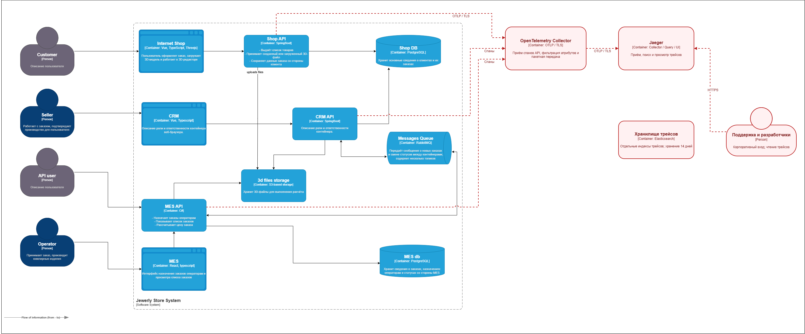

# Архитектурное решение по трейсингу

## Мотивация

Нужно видеть, дошёл ли заказ до MES, завершился ли расчёт и получила ли CRM результат.

**Трейс** показывает цепочку технических операций. **Спан** описывает одну операцию: её начало, длительность и результат.

После внедрения сравниваем четыре показателя:

| Показатель | Что ожидаем |
| --- | --- |
| Время поиска места остановки заказа | Поддержка быстрее находит нужный участок по `order_id`. |
| MTTR — время устранения инцидента | Разработчик быстрее получает сведения об ошибочном или медленном вызове. |
| Доля обращений с невосстановленным путём заказа | Снижается по мере подключения нужных участков. Потери данных трейсинга учитываем отдельно. |
| p95 времени от приёма задания до результата расчёта | Помогает разделить ожидание и сам расчёт. Улучшение проверяем после исправлений. |

Начальные значения измеряем до изменений. Время изготовления изделия зависит и от других этапов работы компании.

## Какие места покрыть

| Участок | Что отслеживаем |
| --- | --- |
| Shop API → Shop DB, S3 | Приём заказа, сохранение данных и загрузку модели. Для БД и S3 создаём отдельные спаны. |
| CRM API → Shop DB | Чтение заказа и сохранение состояния. Действия разных приложений через общую БД связываем по `order_id`. |
| CRM API ↔ RabbitMQ ↔ MES API | Публикацию, получение и обработку сообщения, задержки и повторы. |
| Партнёр → MES API | Прямые B2B-запросы, которые проходят мимо сайта. |
| MES API → S3, MES DB | Чтение модели, расчёт цены, сохранение результата, список заказов и действия оператора. |

Начинаем с MES API, отправки сообщений и обработки в CRM API. Этот путь создаёт заказы партнёров в CRM. Затем подключаем обратные статусы, магазин и S3.

Спаны обращений к RabbitMQ и PostgreSQL создаются в приложениях, которые вызывают эти системы.

## Предлагаемое решение

На схеме сохранены исходные элементы и связи. Красным показаны добавленные компоненты и связи трейсинга.

[Доработанная диаграмма контейнеров](../diagrams/tracing.drawio).

Используем OpenTelemetry для Java и .NET, OpenTelemetry Collector и Jaeger.

В Java и MES подключаем готовую инструментацию HTTP и БД. Для расчёта цены и обработки сообщений добавляем спаны там, где их не хватает.

Приложения асинхронно отправляют спаны в Collector по протоколу OTLP. Collector проверяет поля и передаёт данные в Jaeger. Jaeger показывает трейсы и хранит их в отдельном хранилище Elasticsearch.

Индексы трейсов отделяем от логов Task4. Начальный срок хранения — 14 дней. После измерения объёма и сроков обращений проверяем, достаточно ли этого.

В HTTP передаём контекст через `traceparent` и при необходимости `tracestate`. Для RabbitMQ записываем контекст в заголовки сообщения. Получатель извлекает его перед обработкой.

Публикация, обработка и каждая повторная попытка имеют отдельные спаны. При повторе сохраняем исходный `message_id` и номер попытки.

У одного заказа может быть несколько трейсов: расчёт, подтверждение и действие оператора происходят в разное время. Их связывает `order_id`. Если сохранённого контекста нет, создаём новый `trace_id`. Общая БД сама контекст не передаёт.

На первом этапе сохраняем все технические операции создания и изменения заказов. Для частого чтения списка можно начать с 10% запросов. Отбор выполняем в начале трейса и применяем ко всей цепочке дочерних спанов. Долю уточняем по объёму данных.

### Данные трейсинга

| Группа | Что сохраняем |
| --- | --- |
| Связь операций | `trace_id`, `span_id`, родительский спан или ссылку на связанный спан, `order_id`, `message_id` |
| Источник | Сервис, версию приложения, окружение, экземпляр |
| Время | Начало, конец, длительность, время публикации и получения сообщения |
| Действие | Операцию, HTTP-метод, шаблон маршрута, очередь, этап расчёта, старый и новый статус |
| Результат | Код ответа, безопасное описание типа ошибки, результат обработки, номер попытки |

Полный SQL, содержимое сообщений и моделей, персональные данные не собираем. Доступ к заказу проверяется отдельно от поиска его идентификатора в трейсе.

### Проверка внедрения

На release создаём B2B- и B2C-заказы и находим операции по `order_id`.

Проверяем медленный расчёт, ошибку S3, повтор сообщения и остановку получателя. Должно быть видно, какая операция завершилась последней и где возникла ошибка или ожидание.

При отключении Collector основные запросы продолжают работать. Ошибки отправки спанов должны быть видны в мониторинге.

## Компромиссы

Статус заказа проверяем в приложении и сопоставляем с логами. Отсутствующий спан может быть связан с отбором запросов, непокрытым участком или потерей данных трейсинга.

Физическое изготовление и ручные действия будут видны только при наличии соответствующих событий MES. Операции до подключения трейсинга и удалённые старые трейсы восстановить нельзя. Если обращений по заказам старше 14 дней много, срок хранения пересматриваем.

Исходный код MES доступен, но сложность доработки расчёта пока неизвестна. Начинаем со спана вокруг расчёта и вызовов БД/S3. Подробности добавляем после обнаружения конкретной задержки.

На первом этапе браузеры не подключаем. Очереди отправки спанов ограничены. При длительном сбое возможны потери данных трейсинга; работа с заказами продолжается независимо от доступности Jaeger.

## Безопасность

Collector, Jaeger и Elasticsearch работают во внутренней сети. Отправлять данные могут только разрешённые приложения и Collector. Соединения защищаем TLS с проверкой сертификатов.

Сотрудники входят в Jaeger через корпоративную аутентификацию. Поддержка и разработчики читают разрешённые данные, DevOps управляет системой. Обычным пользователям прямой доступ к Elasticsearch закрыт.

При смене роли права пересматриваются. Административные действия записываются в журнал.

Входящий контекст проверяем по формату и размеру. Дополнительные поля `baggage` извне по умолчанию не принимаем. Заголовки трейсинга не дают прав доступа.

Собираем только разрешённые поля. Пароли, токены, контакты, адреса и подписанные ссылки исключаем до отправки.
