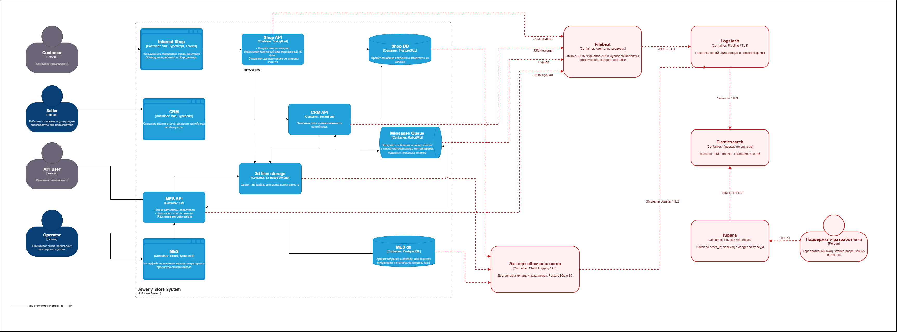

# Архитектурное решение по логированию

## Мотивация

Поддержке нужен общий поиск событий заказа: когда его приняли, как менялся статус и где возникла ошибка. Это позволит разбирать обращения без подключения к каждому серверу.

После внедрения сравниваем:

- время разбора обращения;
- MTTR — время устранения инцидента;
- долю обращений с найденной технической причиной;
- число повторных обращений по зависшему заказу.

Сначала измеряем исходные значения. Затем сравниваем одинаковые периоды. Повторные обращения зависят и от исправления самих ошибок.

## Что собираем

Формат — JSON, одна запись на событие.

Общие поля: время UTC, уровень, сервис, окружение, версия приложения, событие и результат. При наличии добавляем `order_id`, `trace_id` и `span_id`.

Для сообщений сохраняем `message_id`, очередь и номер попытки. Для действий сотрудника — внутренний `actor_id`, если он нужен для разбора.

| Источник | События и дополнительные данные |
| --- | --- |
| Shop API | Создание и отправка заказа: идентификатор, канал B2C, статус. Загрузка модели: технический идентификатор объекта, размер и результат. |
| CRM API | Получение заказа из MES, подтверждение производства, закрытие. Сохраняем старый и новый статус, сотрудника или источник автоматического изменения. |
| MES API | Приём B2B-задания, начало и завершение расчёта: `order_id`, `job_id`, длительность, результат. Действия оператора: старый и новый статус, `actor_id`. |
| CRM API и MES API | Подтверждённая публикация, получение и успешная обработка сообщения. Сохраняем `message_id`, `order_id`, очередь и результат. |
| RabbitMQ | Запуск и остановка узла, подключения приложений, изменения состояния очередей. |
| PostgreSQL и S3 | Доступные журналы ошибок, медленных операций, восстановления и неуспешных обращений. Чувствительные значения удаляем из запросов и ключей объектов. |

Содержимое сообщений, моделей и подписанные ссылки в логи не помещаем. Источник обращения к БД или S3 дополнительно виден в логах API.

На INFO записываем значимые события процесса. Для успешного HTTP-чтения достаточно маршрута, кода ответа, длительности и идентификатора для связи записей. Тело запроса не сохраняем.

| Уровень | Когда используем |
| --- | --- |
| INFO | Штатные значимые события: создание заказа, завершение расчёта, смена статуса |
| WARN | Временный сбой с повтором, повторная доставка, отказ при перегрузке, неожиданный переход статуса |
| ERROR | Операция не выполнена: ошибка расчёта, сохранения или исчерпание повторов |
| FATAL | Сервис не может запуститься или продолжать работу |
| DEBUG и TRACE | Временная подробная диагностика выбранного компонента при согласованном разборе инцидента |

В production DEBUG и TRACE обычно выключены. Правила исключения секретов действуют на всех уровнях.

## Порядок внедрения логирования и трейсинга

1. MES API: приём B2B-задания, расчёт и отправка результата. CRM API: получение сообщения и сохранение заказа. Логи и спаны связываем одинаковыми идентификаторами заказа и операции.
2. CRM API → RabbitMQ → MES API: подтверждение производства и дальнейшие статусы. Затем подключаем список и действия операторов.
3. Shop API, общая Shop DB и S3: завершаем покрытие заказов магазина.

Журналы RabbitMQ и БД DevOps подключает с первого этапа.

## Предлагаемое решение

На схеме сохранены исходные элементы и связи. Красным показаны добавленные компоненты и связи сбора логов.

[Схема сбора логов](../diagrams/logging.drawio).

Используем ELK:

- Filebeat читает журналы на серверах API и RabbitMQ;
- Logstash проверяет и обрабатывает записи;
- Elasticsearch хранит данные и выполняет поиск;
- Kibana показывает результаты и панели.

Java-приложения записывают JSON через Logback, MES — через .NET logging.

Для управляемых PostgreSQL и S3 используем доступный интерфейс выгрузки облачных журналов. При настройке проверяем, какие журналы предоставляет сервис. Логи обращений со стороны API собираются независимо от облачной выгрузки.

Доставка выполняется асинхронно. У Filebeat предусмотрена ограниченная дисковая очередь, у Logstash — сохраняемая на диске очередь.

При коротком сбое Elasticsearch записи накапливаются и отправляются после восстановления. Размер очередей рассчитываем по потоку логов. Следим за заполнением и задержкой доставки.

При переполнении возможна потеря диагностических записей. Состояние заказа надёжно сохраняется в бизнес-системе.

### Безопасность

Пароли, токены, cookie, строки подключения, тела заказов, контакты и модели исключаем ещё в приложении, до записи локального файла. Проверяем также текст ошибок: в него могут попасть URL и параметры запроса.

Logstash выполняет дополнительную проверку. Для поиска событий заказа достаточно технического `order_id`.

Соединения защищаем TLS. Компоненты размещаем во внутренней сети. Защиту Elasticsearch `xpack.security` сохраняем включённой.

| Роль | Доступ |
| --- | --- |
| Агенты | Передача данных |
| Поддержка | Чтение разрешённых индексов через Kibana |
| Разработчики | Чтение логов своих систем |
| DevOps | Управление настройками хранения |

Личные и служебные учётные записи разделяем. Административные действия и экспорт данных записываем в журнал. Права production и тестовых окружений разделяем.

### Хранение и размер

Для приложений используем постоянные имена индексов — alias:

- `prod-shop`;
- `prod-crm`;
- `prod-mes`;
- `prod-infra` для RabbitMQ и облачных журналов.

Logstash отправляет записи через alias в текущий индекс. Шаблон задаёт поля и настройки новых индексов. Политика ILM управляет переключением и удалением.

Начальные настройки production:

- новый индекс создаётся через сутки или при размере основного шарда 10 ГиБ;
- один основной шард и одна реплика на другом узле;
- старый индекс удаляется через 30 дней после переключения.

Это даёт примерно 30–31 день хранения отдельных записей. Для dev и release задаём 7 дней, для подробных DEBUG/TRACE — отдельный индекс на 2 дня.

Реплика — дополнительная копия данных. Переключение записи на новый индекс называется rollover.

Объём рассчитываем по измеренному потоку. Условный пример:

| Условие или этап | Значение |
| --- | --- |
| Поток | 50 событий в секунду |
| Средний размер записи | 1 КиБ |
| Объём за сутки | Около 4,1 ГиБ |
| За 30 дней | Около 124 ГиБ |
| С коэффициентом индексации 1,5 и одной репликой | Около 371 ГиБ |
| С дополнительным запасом 30% | Около 482 ГиБ |

Здесь 1 КиБ — 1024 байта, 1 ГиБ — 1024³ байта.

Это пример с допущениями. Трейсы Task3 в него не входят. За первую неделю измеряем реальный поток и размер индексов, затем уточняем диск и rollover.

Типы полей задаём заранее:

| Данные | Тип |
| --- | --- |
| Время | `date` |
| Уровень, сервис, идентификаторы, статус | `keyword` |
| Длительность | Числовой |
| Безопасный текст ошибки | `text` |

Количество полей ограничиваем. Входящие JSON-записи не должны бесконтрольно расширять структуру индекса. Хранение и удаление проверяем на release.

### Анализ и уведомления

В Kibana создаём поиск по `order_id` и панели ошибок, переходов статуса и неуспешной обработки сообщений. По `trace_id` предусматриваем переход в Jaeger.

Ошибки и предупреждения сопоставляем с метриками Task2.

Настраиваем уведомления о:

- серии ошибок создания заказа или расчёта;
- сообщениях в очереди неуспешных;
- отсутствии обработки при поступающих заказах;
- задержке доставки логов.

Получатели — ответственный разработчик и DevOps. При влиянии на заказы уведомляем продакта. Одинаковые события группируем.

Аномалии определяем простыми правилами и сравнением с обычным потоком того же канала. Всплеск B2B-заказов проверяем вместе с RPS, ошибками и известными действиями партнёров. Сам всплеск ещё не подтверждает DDoS.

Правила проверяет задача по расписанию через API Elasticsearch. Сработавшие сигналы передаются в Alertmanager. Отдельную платную функцию Kibana не закладываем.

Проверяем поиск всех значимых событий тестового заказа, отсутствие запрещённых данных, восстановление доставки после остановки Elasticsearch и ограничения прав поддержки.
