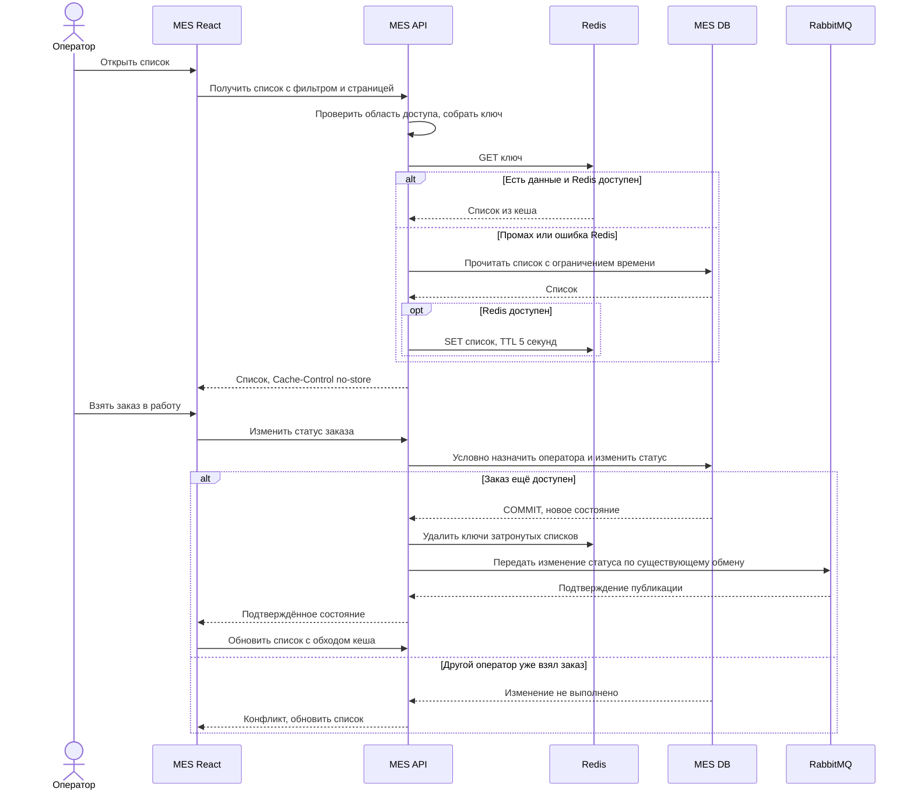

# Архитектурное решение по кешированию

## Мотивация

Операторы часто открывают первые страницы списка MES. Фильтр и пагинация уже есть, но список загружается медленно.

Предлагаю временно сохранять результаты повторяющихся запросов. Это уменьшит число чтений MES DB.

Сначала измеряем запрос и проверяем план, сортировку и индексы БД. Кеш поможет повторным чтениям. Первый запрос, расчёт новой модели и ошибки передачи сообщений требуют отдельных проверок.

В кеш помещаем данные строк списка: `order_id`, время создания, статус, краткое описание, цену при наличии и назначенного оператора. Документы, контакты и модели не сохраняем.

При назначении заказа проверяем актуальное состояние в БД.

## Предлагаемое решение

Используем Redis на стороне MES API. Подходящий результат смогут получать несколько операторов с одинаковыми параметрами запроса и областью доступа.

Для ответа списка задаём `Cache-Control: no-store`. Это исключает дополнительное хранение ответа в HTTP-кеше браузера.

Выбираю Cache-Aside:

1. MES API проверяет Redis.
2. Если список найден, возвращает его.
3. Если списка нет, читает БД и сохраняет результат в Redis.

Начальный TTL — 5 секунд с момента записи в кеш. Его допустимость проверяем с операторами.

Обращение к Redis ограничено тайм-аутом. При ошибке кеша API читает БД. Количество таких одновременных чтений и время ожидания ограничиваем, чтобы отказ Redis не перегрузил БД.

| Паттерн | Решение |
| --- | --- |
| Cache-Aside | Подходит для повторных запросов. В кеше появляются только востребованные результаты. |
| Write-Through | Требует согласованно обновлять БД и кеш. Один заказ влияет на несколько списков, страниц и счётчиков, поэтому запись усложняется. |
| Refresh-Ahead | Заранее обновляет востребованные результаты. Спрос пока не измерен, поэтому есть риск лишних запросов к БД. На старте не выбираю. |

Ключ:

```text
mes:orders:{scope}:{status}:{sort}:{page}:{pageSize}
```

В нём учитываем разрешённую область данных, статус, сортировку, страницу и её размер. Все дополнительные параметры, влияющие на результат, тоже включаем в ключ.

MES API проверяет значения и приводит их к единому формату. Размер страницы ограничиваем. Для разных областей доступа используем разные ключи.

Сначала кешируем первые три страницы сортировки «новые сначала» и ограниченный набор статусов. Редкие произвольные фильтры направляем в БД.

### Последовательность чтения и записи



Статус заказа и назначение оператора меняются одной атомарной операцией БД с проверкой текущего состояния.

Если два оператора пытаются взять один свободный заказ, успешно назначить его сможет только один. Второй получает конфликт.

Изменение заказа и событие для отправки сохраняются в одной транзакции. При ошибке публикации событие повторно отправляется механизмом из Task1. Заказ при этом не создаётся заново.

Подтверждение RabbitMQ относится к публикации сообщения. Успешная обработка в CRM проверяется отдельно.

Если после COMMIT недоступен Redis, изменение заказа остаётся успешным. Сбой удаления кеша записываем в лог. Срок действия старой записи ограничивает TTL.

### Инвалидация

После COMMIT удаляем кешированные списки, на которые повлияло изменение.

При смене статуса удаляем списки старого статуса, нового статуса и «все», их первые три страницы и счётчики.

То же правило применяем при создании заказа, смене назначения и других изменениях данных списка. Оно вызывается обработчиками команд оператора, результатов расчёта и сообщений RabbitMQ.

Ключи вычисляем из известных кешируемых вариантов. Поиск через `KEYS` и полное сканирование при каждом изменении не используем. Новый фильтр добавляем вместе с правилом его удаления.

| Стратегия | Решение |
| --- | --- |
| Только TTL | Старый список остаётся до истечения срока. Используем как дополнительную страховку. |
| Удаление затронутых ключей после изменения | Основной вариант. Учитывает команды оператора и фоновые изменения. |
| Очистка при каждом чтении | Повторные запросы снова пойдут в БД, польза кеша пропадёт. |
| Очистка только по `order_id` | Не обновит готовые списки, страницы и счётчики. |
| Полная очистка Redis | Удалит и незатронутые результаты, увеличит число запросов к БД. |

После удаления возможна гонка:

1. Один запрос начинает читать старый список.
2. Другой запрос изменяет заказ и удаляет кеш.
3. Первый запрос завершает чтение и сохраняет старый результат в Redis.

Поэтому пять секунд TTL отсчитываются от записи результата в Redis. Свежесть строго через пять секунд после COMMIT не гарантируется: влияет и длительность начатого чтения. Его время ограничиваем тайм-аутом.

В этом решении допускается небольшое устаревание списка. Более строгая свежесть потребует доработки. Назначение заказа уже защищено проверкой в БД.

После своей успешной команды интерфейс показывает подтверждённое состояние и обновляет список с обходом кеша. У остальных операторов список обновляется периодически. Интервал согласуем с допустимой задержкой и нагрузкой.

Прямые изменения в MES DB обходят обработчики инвалидации. Они станут видны после истечения TTL и нового чтения.

Проверяем попадание и промах, одновременную работу двух операторов, новый заказ через API, изменение из сообщения и отказ Redis.

При одинаковой нагрузке сравниваем p95 списка и количество чтений MES DB. Отдельно проверяем, что устаревшая строка не позволяет двум операторам взять один заказ.
